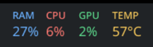
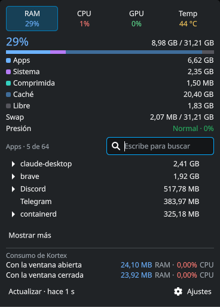

# Kortex

Monitor de sistema: RAM, CPU, GPU y temperatura siempre a la vista. Un clic abre el detalle con las apps que más consumen.

Tiene una versión para KDE Plasma 6, en `linux/`, y otra para la barra de menú de macOS, en `macos/`.

## Linux





### Requisitos

- KDE Plasma 6 y systemd
- x86-64 con glibc 2.34 o superior
- GPU NVIDIA con su driver para ver los datos de GPU
- CachyOS, la única distribución probada

### Instalar

```bash
curl -LO https://github.com/swtnicolas/kortex/releases/latest/download/kortex-install.sh
bash kortex-install.sh
```

Luego agrega **Kortex** al panel desde "Añadir widgets".

### Actualizar

```bash
curl -LO https://github.com/swtnicolas/kortex/releases/latest/download/kortex-install.sh
bash kortex-install.sh
systemctl --user restart plasma-plasmashell
```

Los ajustes se conservan. El último comando recarga el panel para que muestre la versión nueva.

### Desinstalar

```bash
bash kortex-install.sh --uninstall
```

### Compilar desde el código

```bash
bash linux/scripts/install.sh
```

Requiere Rust. `bash linux/scripts/package.sh` genera `linux/dist/kortex-install.sh`.

## macOS

No hay descarga para Mac: la app se compila en el propio equipo, porque macOS bloquea una copia descargada sin firma de Apple.

### Requisitos

- Mac con Apple Silicon
- macOS 27.2, la única versión probada
- Command Line Tools de Xcode (`xcode-select --install`)

### Instalar

```bash
git clone https://github.com/swtnicolas/kortex.git
bash kortex/macos/scripts/install.sh
```

Compila la app, la copia en `~/Applications/Kortex.app` y la abre.

Para que Kortex controle los ventiladores, instala su ayudante; pide la contraseña de administrador una sola vez:

```bash
bash kortex/macos/scripts/install-fans.sh
```

### Actualizar

```bash
git -C kortex pull
bash kortex/macos/scripts/install.sh
```

Si el ayudante de ventiladores cambió, el script lo avisa y hay que volver a correr `install-fans.sh`.

### Desinstalar

```bash
pkill -x Kortex; rm -rf ~/Applications/Kortex.app
sudo rm -f /Library/PrivilegedHelperTools/local.kortex.fans
```

Para borrar también los ajustes:

```bash
defaults delete local.kortex
```
